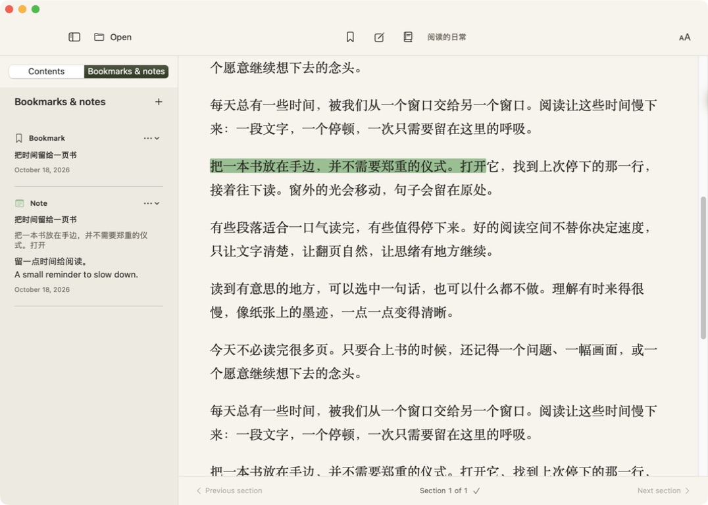

# Folio

A small, quiet EPUB reader for Mac. Open a book and start reading.

Native SwiftUI and WebKit. Local files, no account, no server, no third-party runtime dependencies.


## Download and install

[Download Folio for Mac](https://github.com/Michaellzd/folio-reader/releases/latest/download/Folio-macOS-universal.zip) · [All releases](https://github.com/Michaellzd/folio-reader/releases)

Choose **Folio-macOS-universal.zip** under release assets. The source-code archives are for developers. Requires **macOS 14 or later**; the universal app contains Apple Silicon and Intel builds. Apple Silicon is tested locally; Intel is cross-compiled.

1. Download and unzip the application archive.
2. Drag **Folio.app** to Applications and open it.
3. Click **Open EPUB**, press **⌘O**, or drop an EPUB onto the window. Finder's **Open With → Folio** also works.

The current release uses an ad hoc signature and is **not Apple-notarized**. For a downloaded app, macOS may require **System Settings → Privacy & Security → Open Anyway** after the first launch attempt. See [Apple's instructions](https://support.apple.com/en-us/102445).

## Reading

- EPUB 2 and EPUB 3, including contents, nested sections, anchors, local images, and chapter navigation.
- A collapsible contents sidebar, adjustable text size, and day/night paper.
- Automatic reading-position saves and automatic continuation of the last book on launch.
- Manual bookmarks, four highlight colors, and notes attached to exact passages.
- **简体中文 · English · 日本語 · Español**. The interface follows your system language on first launch. Use **Reading appearance → Interface language** to change it; the choice is saved locally.

The book stays in its original language. DRM-encrypted books, ZIP64 archives, fixed-layout reproduction, vertical typesetting, and interactive EPUB scripts are outside this first version. This is a reflowable text reader, so publisher layouts can look different. Remote links and remote book resources are blocked.

| Shortcut | Action |
| --- | --- |
| ⌘O | Open EPUB |
| ⌘S | Save a bookmark; save the note when its editor is open |
| ⇧⌘N | Add a note at the current position or to selected text |
| ⌘Return | Save the open note |
| ⌘← / ⌘→ | Previous / next spine section |
| ⌃⌘S | Show / hide contents |
| ⌘+ / ⌘− | Increase / decrease text size |
| ⇧⌘D | Toggle day / night |

## 中文

Folio 是一款简单的 Mac EPUB 阅读器。下载上面的 ZIP，解压后把 **Folio.app** 拖进“应用程序”。打开 EPUB 即可阅读，支持拖入文件、目录跳转、字号调整、日夜主题和阅读位置保存。

支持中、英、日、西班牙语界面，在右上角的阅读设置中切换。书籍正文保留原文。所有阅读操作都在本地完成。

## Bookmarks, highlights, and notes

**Continue where you left off.** The app saves your chapter and visible paragraph as you read and when you close it. On the next launch it opens the last available book at that position. The checkmark beside the section counter confirms that progress was saved locally. Paragraph anchors help retain your place when the window or font size changes. Older versions' saved positions migrate when a book is opened.

**Save a bookmark.** Click the bookmark icon in the top bar, or press **⌘S**, to keep a fixed reference point without changing your automatic reading progress. Open **Bookmarks & notes** to revisit saved items.

**Highlight a passage.** Select text in the book. A small toolbar appears at the bottom of the reading area; choose **yellow, green, blue, or pink** to apply a persistent highlight. Text can span paragraphs and inline formatting. Overlapping highlights are supported; the most recently applied color is visible in overlaps.

**Attach a note.** Select text and choose **Add note**, then choose a color, write your note, and click **Save note**. You can also click an existing highlight to add or edit its note. The top-bar note button and **⇧⌘N** also work for notes at the current position without selected text. Notes are saved when you click Save note or use the save shortcut; Cancel discards the editor's unsaved changes.

**Review and edit.** The sidebar's **Bookmarks & notes** tab lists saved positions, passages, and notes. Click an item to jump back; its menu lets you edit a note or delete the item. A note's editor can also change its highlight color. Removing a highlight removes its attached note. The EPUB itself is never rewritten.



**Language.** Bookmarks, highlight controls, color names, note editors, save confirmations, dates, and error messages follow the selected interface language: Chinese, English, Japanese, or Spanish. Your own notes and book excerpts retain their original text.

**Moving a book.** Reading data is keyed by the EPUB file's SHA-256 fingerprint. Moving or copying the same EPUB preserves its bookmarks, highlights, and notes when you reopen it. Editing or replacing the EPUB's contents creates a different fingerprint. If the last file was moved, use Open EPUB to select its new location.

### 使用方法

阅读位置会自动保存，下次启动直接继续。点顶部书签或按 **⌘S** 可以额外保存一个固定位置。选中文字后，在底部浮动工具栏选择黄、绿、蓝、粉色进行标注；点“添加笔记”可选择颜色并记录想法。点已有标注可以补充或编辑笔记，保存后重新打开仍会显示。在侧栏“书签与笔记”中可以跳回原文、编辑或删除。笔记编辑器需要点“保存笔记”或按快捷键保存，取消会放弃本次编辑。

### 日本語

読書位置は自動保存され、次回の起動時に続きから開きます。**⌘S** でしおりを保存できます。本文を選択すると下部にツールバーが表示され、黄・緑・青・ピンクでハイライトできます。「メモを追加」でメモと色を保存し、既存のハイライトをクリックすると編集できます。「しおりとメモ」の一覧から原文に戻れます。

### Español

La posición se guarda automáticamente y la app reanuda la lectura al abrirse. Usa **⌘S** para guardar un marcador. Selecciona texto y elige amarillo, verde, azul o rosa en la barra inferior para resaltarlo. **Añadir nota** permite guardar un comentario y un color; haz clic en un resaltado existente para editar su nota. La pestaña **Marcadores y notas** permite volver al pasaje, editar o eliminar elementos.

## Privacy

Books are extracted to a temporary local folder. Appearance, language, last-file paths, and legacy position data use local macOS preferences. Progress, bookmarks, highlight ranges, excerpts, and notes are saved as JSON under **~/Library/Application Support/Folio/**, using atomic writes and file permissions restricted to the current user. Back up that folder to preserve your reading data. Notes are stored as ordinary local text, without additional application encryption or cloud sync. If saved data cannot be read, the app shows an error and avoids overwriting it.

There is no developer backend, analytics, account, or upload. Book scripts are disabled and remote resources are blocked. Extracted book contents are removed on normal close; saved reading data remains. A crash may leave temporary book files for macOS to clean up.

## Build from source

Install Apple's Command Line Tools (`xcode-select --install`). Swift 6+ and macOS 14+ are required; Python 3 is used only for tests. No package installation is needed.

```sh
./test.sh
./test-web.sh
./build.sh
open build/Folio.app
./package.sh
```

The build creates a universal application with both `arm64` and `x86_64` executables. `package.sh` creates a ready-to-use ZIP and SHA-256 checksums in `dist/`. To test your own book:

```sh
./test.sh /path/to/your-book.epub
```

The fixture suite checks EPUB3 navigation, nesting, anchor links, Unicode and escaped filenames, missing-TOC fallback, spine selection, four-language translation coverage, ZIP corruption, path traversal, symlinks, encryption, and truncated archives. Persistence tests cover restart recovery, file moves, multilingual notes, highlight metadata, edits, deletion, damaged storage, and write failures. `test-web.sh` exercises the actual system WebKit with author scripts disabled, including Unicode and inline selections, exact highlight ranges, duplicate passages, overlapping colors, safe note rendering, repeat rendering, removal, and the native note-click bridge. Real books and personal notes are never included in this repository or release.

See [AGENTS.md](AGENTS.md) for the code map and contribution rules, [DESIGN.md](DESIGN.md) for visual choices, and [RELEASING.md](RELEASING.md) for publishing.

## License

[MIT](LICENSE). Built with Apple's system frameworks and system zlib. Design guidance: [Taste](https://github.com/Hmbown/taste) and [Impeccable](https://github.com/pbakaus/impeccable).

## Say hello

Built by [Michael Lu](https://x.com/michael_lu_03).

## More products

- [OwnWords](https://github.com/Michaellzd/ownwords) — your own thoughts, expressed clearly.
- [AI Takeaway](https://aitakeaway.net/)
- [Auralume AI](https://auralumeai.com/)
- [Encorette](https://burningbridgesmv.org/)
